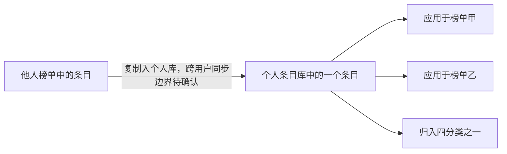

# 条目与榜单

| 属性 | 内容 |
| --- | --- |
| 稳定标识 | CON-001 |
| 整理日期 | 2026-11-09 |
| 资料基准 | Epic 7，正文更新于 2026-07-19；6.24 决策清单 |
| 需求确认状态 | 整理草案，待产品负责人审核；以下为资料记载 |
| 实现状态 / 上线状态 | 未核实 / 未核实 |
| 审核人 / 审核时间 | 尚无 |

## 核心概念

| 概念 | 产品含义 | 依据 |
| --- | --- | --- |
| 条目 | 用户记录的具体对象，包含名称及可选的地点、照片、评价等信息 | [Epic 7·US-27·新建表单](../../sources/原始资料/2026-11-09/Phase%202/PRD%20文档/1.2%20Epic7-条目库、复制与智能推荐.md) |
| 个人条目库 | 用户名下所有条目的全量素材库；新建条目自动进入，条目库为个人数据 | [Epic 7·US-24、US-27](../../sources/原始资料/2026-11-09/Phase%202/PRD%20文档/1.2%20Epic7-条目库、复制与智能推荐.md) |
| 分类文件夹 | 玩乐、美食、好物、其他四个固定分类入口，用于组织个人条目 | [Epic 7·US-24·四分类文件夹](../../sources/原始资料/2026-11-09/Phase%202/PRD%20文档/1.2%20Epic7-条目库、复制与智能推荐.md) |
| 榜单 | 有标题与类别、用于组织并表达个人评级的内容；可以应用条目库中的条目 | [Epic 7·US-29、US-30](../../sources/原始资料/2026-11-09/Phase%202/PRD%20文档/1.2%20Epic7-条目库、复制与智能推荐.md) |
| 复用 | 同一个个人条目应用到多个榜单，内容修改保持同步 | [Epic 7·US-25·编辑全局同步](../../sources/原始资料/2026-11-09/Phase%202/PRD%20文档/1.2%20Epic7-条目库、复制与智能推荐.md) |
| 复制 | 从他人榜单将条目加入自己的库；资料要求保留来源关联，不做重复检测 | [Epic 7·US-28](../../sources/原始资料/2026-11-09/Phase%202/PRD%20文档/1.2%20Epic7-条目库、复制与智能推荐.md)、[6.24 清单·ID 关联](../../sources/原始资料/2026-11-09/Phase%202/前期调研与决策/2.3%206.24-PRD-Review-决策变更清单.md) |

## 内容关系

可以把条目库理解为个人素材库，把榜单理解为使用素材表达品味的作品。个人库内同一条目的内容在多个榜单复用，修改素材会影响使用它的榜单。这是产品关系，不是经代码验证的数据库结构。

同一用户的复用与跨用户复制是两种关系。保留来源 ID 并不能证明双方内容会持续同步。跨用户行为见 [Q-007](../../questions/待确认事项.md#q-007-跨用户复制后的同步边界未确认)。

## 需要区别的动作

| 动作 | 资料支持的影响范围 | 尚不能推断的部分 |
| --- | --- | --- |
| 编辑个人库内条目 | 所有使用该条目的个人榜单同步更新；榜单内修改条目也同步到库 | 他人复制后的内容是否跟随更新 |
| 从个人库删除条目 | 关联榜单同步移除该条目，资料要求二次确认且不设回收站 | 跨用户副本处理、删除后空榜单等完整边界 |
| 删除榜单 | 条目仍保留在个人条目库 | 当前实现是否完全一致 |
| 对条目评级 | 表达用户在榜单中的评价；观看者的评分另属 Epic 8 | 作者评级与观众评分的完整统计模型 |

前 3 行依据：[Epic 7·US-25·编辑与删除](../../sources/原始资料/2026-11-09/Phase%202/PRD%20文档/1.2%20Epic7-条目库、复制与智能推荐.md)。评级背景：[产品全貌·五档评级体系](../../sources/原始资料/2026-11-09/Phase%202/Taste%20产品全貌（Phase%202）.md)。观众评分资料存在语义冲突，见 [Q-001](../../questions/待确认事项.md#q-001-五档评价的名称与含义存在冲突)。

## 历史变化

2026-06-24 决策清单记录：条目库从部分复用素材的集合调整为个人全量素材库；编辑/删除改为全局同步；复制需要建立源条目 ID 关联。该清单同时说明了调整理由，应保留为历史依据。[来源·架构级变更 1—3](../../sources/原始资料/2026-11-09/Phase%202/前期调研与决策/2.3%206.24-PRD-Review-决策变更清单.md)

早期业务问答中的独立副本、无来源追溯等内容只用于解释当时方案，不能直接替代后续规则。同步原则适用同一条目的引用，不能据此宣布所有跨用户副本共用同一实体。

## 关联知识

- [条目库与复用](../功能说明/条目库与复用.md)：具体流程、容量与权限。
- [待确认事项](../../questions/待确认事项.md)：评分、容量及跨用户同步等问题。
